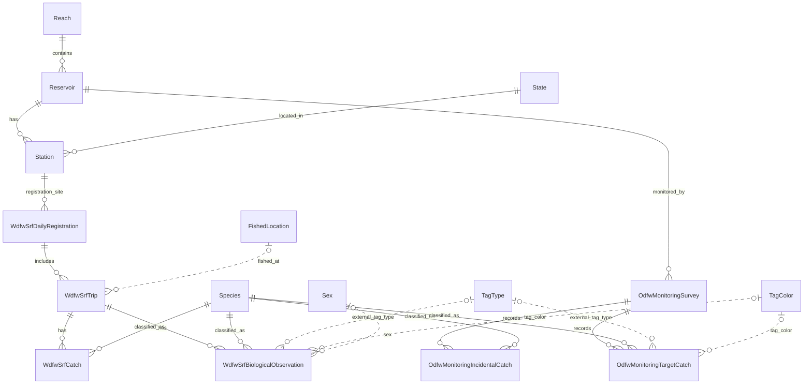

# NPMP database schema

This document describes the current schema defined by the `NpmpDatabase` SQL Database Project. It is a presentation aid; the SQL files in `database/NpmpDatabase/Tables/` remain the authoritative source.

## Relationship diagram

The cardinality markers show the database relationship: `||` means exactly one, `o|` zero or one, and `o{` zero or many. Dashed connectors represent foreign keys whose child-side column is nullable.

`FishedLocationId`, `ExternalTagTypeId`, `TagColorId`, and `SexId` are nullable foreign keys. Every other foreign key shown is required.

## Common conventions

- All tables are in the `dbo` schema and use an `INT IDENTITY` primary key.
- All tables have `CreatedAt` and `UpdatedAt` columns: non-null `DATETIME2(7)` UTC values that default to `SYSUTCDATETIME()`. An update trigger maintains `UpdatedAt`.
- `PK` below identifies a primary key; `FK` identifies a foreign key; `UQ` identifies a unique constraint or unique index. `NULL` is explicitly noted for nullable fields; all other fields are required.
- No lookup/reference rows are seeded by this project.

## Reference and location tables

### Species

| Column | Type | Notes |
| --- | --- | --- |
| SpeciesId | INT | PK |
| CommonName | NVARCHAR(255) | UQ |
| ScientificName | NVARCHAR(255) NULL | Unique when present |

### Sex

| Column | Type | Notes |
| --- | --- | --- |
| SexId | INT | PK |
| SexCode | NVARCHAR(20) | UQ |
| SexName | NVARCHAR(100) | UQ |

### TagType

| Column | Type | Notes |
| --- | --- | --- |
| TagTypeId | INT | PK |
| TagTypeCode | NVARCHAR(50) | UQ |
| TagTypeName | NVARCHAR(255) | UQ |

### TagColor

| Column | Type | Notes |
| --- | --- | --- |
| TagColorId | INT | PK |
| TagColorCode | NVARCHAR(50) | UQ |
| TagColorName | NVARCHAR(255) | UQ |

### FishedLocation

| Column | Type | Notes |
| --- | --- | --- |
| FishedLocationId | INT | PK |
| Code | NVARCHAR(50) | UQ |
| Description | NVARCHAR(255) | |

### State

| Column | Type | Notes |
| --- | --- | --- |
| StateId | INT | PK |
| StateCode | CHAR(2) | UQ |
| StateName | NVARCHAR(100) | UQ |

### Reach

| Column | Type | Notes |
| --- | --- | --- |
| ReachId | INT | PK |
| ReachCode | NVARCHAR(50) | UQ |
| CommonName | NVARCHAR(255) NULL | |

### Reservoir

| Column | Type | Notes |
| --- | --- | --- |
| ReservoirId | INT | PK |
| ReservoirCode | NVARCHAR(50) | UQ |
| ReservoirName | NVARCHAR(255) | |
| ReachId | INT | FK to `Reach.ReachId` |

### Station

| Column | Type | Notes |
| --- | --- | --- |
| StationId | INT | PK |
| StationName | NVARCHAR(255) | Unique with `ReservoirId` |
| ReservoirId | INT | FK to `Reservoir.ReservoirId` |
| City | NVARCHAR(255) NULL | |
| StateId | INT | FK to `State.StateId` |
| Latitude | DECIMAL(9,6) | -90 through 90 |
| Longitude | DECIMAL(9,6) | -180 through 180 |

## ODFW monitoring

### OdfwMonitoringSurvey

| Column | Type | Notes |
| --- | --- | --- |
| OdfwMonitoringSurveyId | INT | PK |
| ReservoirId | INT | FK to `Reservoir.ReservoirId` |
| SurveyDate | DATE | |
| SurveyStartTime | TIME(0) NULL | |
| SurveyEndTime | TIME(0) NULL | Must be later than start time when both are present |
| SurveyEffort | INT NULL | Nonnegative |

### OdfwMonitoringIncidentalCatch

| Column | Type | Notes |
| --- | --- | --- |
| OdfwMonitoringIncidentalCatchId | INT | PK |
| OdfwMonitoringSurveyId | INT | FK to `OdfwMonitoringSurvey.OdfwMonitoringSurveyId` |
| SpeciesId | INT | FK to `Species.SpeciesId` |
| CatchCount | INT | Nonnegative; unique with `OdfwMonitoringSurveyId` and `SpeciesId` |

### OdfwMonitoringTargetCatch

| Column | Type | Notes |
| --- | --- | --- |
| OdfwMonitoringTargetCatchId | INT | PK |
| OdfwMonitoringSurveyId | INT | FK to `OdfwMonitoringSurvey.OdfwMonitoringSurveyId` |
| SpeciesId | INT | FK to `Species.SpeciesId` |
| ForkLengthMillimeters | INT NULL | Positive when present |
| WeightGrams | DECIMAL(10,2) NULL | Positive when present |
| ExternalTagCode | NVARCHAR(255) NULL | |
| PitTagCode | NVARCHAR(255) NULL | |
| ExternalTagTypeId | INT NULL | FK to `TagType.TagTypeId` |
| TagColorId | INT NULL | FK to `TagColor.TagColorId` |

## WDFW Sport Reward Fishery (SRF)

### WdfwSrfDailyRegistration

| Column | Type | Notes |
| --- | --- | --- |
| WdfwSrfDailyRegistrationId | INT | PK |
| RegistrationDate | DATE | |
| StationId | INT | FK to `Station.StationId` |

### WdfwSrfTrip

| Column | Type | Notes |
| --- | --- | --- |
| WdfwSrfTripId | INT | PK |
| WdfwSrfDailyRegistrationId | INT | FK to `WdfwSrfDailyRegistration.WdfwSrfDailyRegistrationId` |
| FishedLocationId | INT NULL | FK to `FishedLocation.FishedLocationId` |

### WdfwSrfCatch

| Column | Type | Notes |
| --- | --- | --- |
| WdfwSrfCatchId | INT | PK |
| SpeciesId | INT | FK to `Species.SpeciesId` |
| CaughtCount | INT | Nonnegative |
| ReleasedCount | INT | Nonnegative; cannot exceed `CaughtCount` |
| SrfQualifyingCount | INT NULL | Nonnegative and cannot exceed `CaughtCount` when present |
| WdfwSrfTripId | INT | FK to `WdfwSrfTrip.WdfwSrfTripId`; unique with `SpeciesId` |

### WdfwSrfBiologicalObservation

| Column | Type | Notes |
| --- | --- | --- |
| WdfwSrfBiologicalObservationId | INT | PK |
| SpeciesId | INT | FK to `Species.SpeciesId` |
| ForkLengthMillimeters | INT NULL | Positive when present |
| PitTagCode | NVARCHAR(255) NULL | |
| ExternalTagTypeId | INT NULL | FK to `TagType.TagTypeId` |
| TagColorId | INT NULL | FK to `TagColor.TagColorId` |
| SexId | INT NULL | FK to `Sex.SexId` |
| WdfwSrfTripId | INT | FK to `WdfwSrfTrip.WdfwSrfTripId` |

## Relationship and integrity summary

- The geographic hierarchy is Reach -> Reservoir -> Station; each station also belongs to a state.
- An ODFW survey belongs to one reservoir and can have many target-catch observations and, at most, one incidental-catch aggregate for each species.
- An SRF daily registration belongs to one station. It can have many trips; each trip can have many catch aggregates and biological observations.
- An SRF catch aggregate is unique per trip and species. The counts prevent releases or qualifying fish from exceeding fish caught.
- Species, sex, tag type, tag color, fished location, and geographic entities are shared lookup/reference tables. Foreign keys enforce their use by operational records.

For business definitions of the fields and program terms, see [`CONTROLLED_VOCABULARY.md`](../CONTROLLED_VOCABULARY.md).
